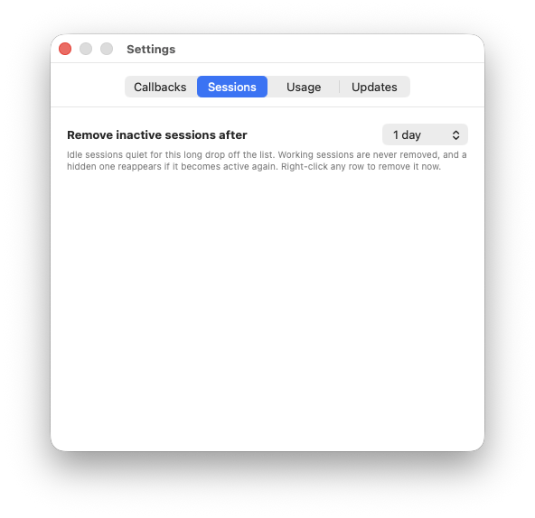
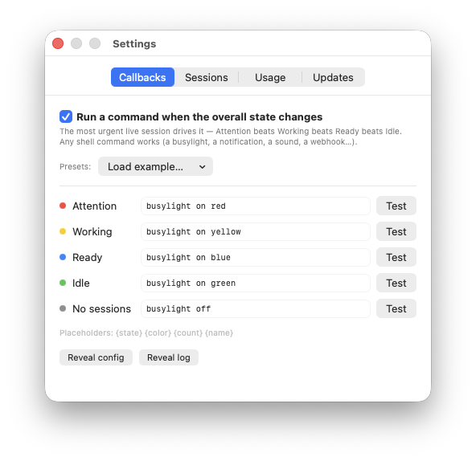
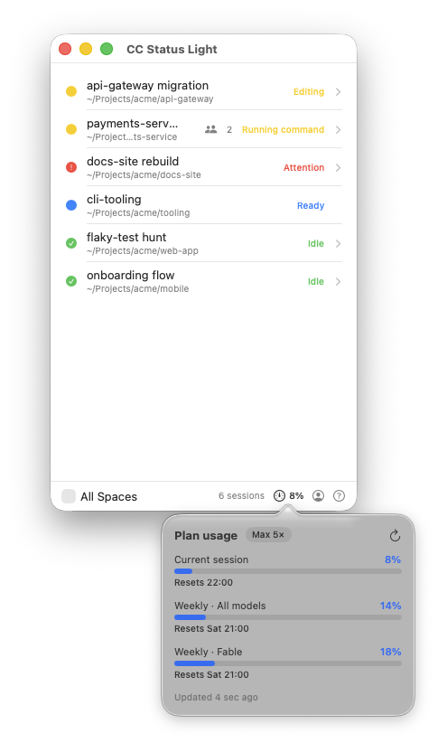
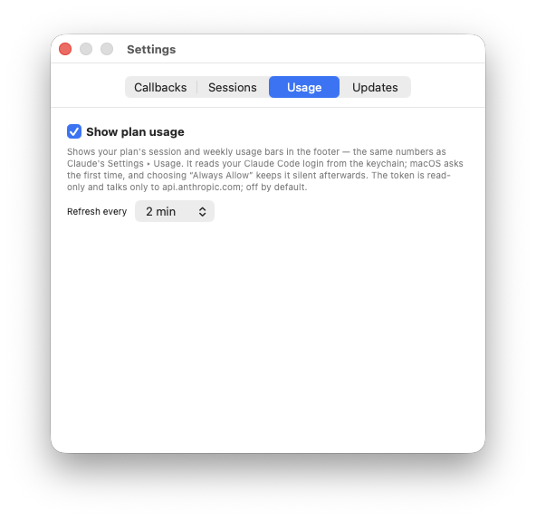
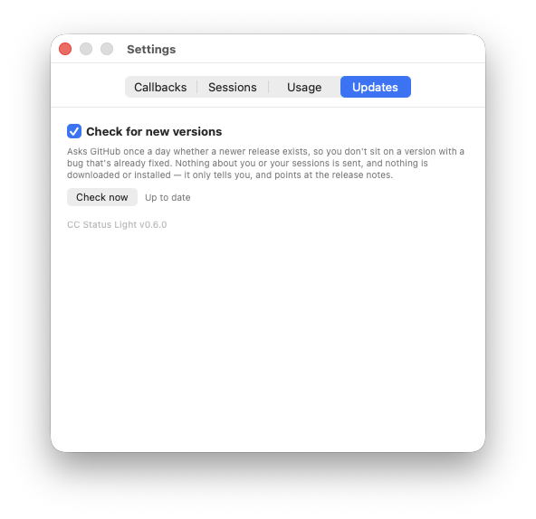

# CC Status Light

A tiny native macOS app that shows what your running Claude Code sessions are
doing — one row each, in a single window.

Native Swift + SwiftUI (AppKit-managed window).


## What it shows

One row per session: its name, live state, the current activity when working
(Editing, Reading, Running command, Thinking, Subagents, Compacting…), a subagent
count, and the working directory.

| State | Meaning |
| ------ | ------- |
| **Ready** | Session started, waiting for you |
| **Working** | Actively running (tools, thinking, subagents, compacting) |
| **Attention** | Needs you — a permission or elicitation prompt |
| **Idle** | Finished its turn, nothing pending |
| **Ended** | Session closed |

State comes from tailing each session's JSONL transcript — including subagent
awareness (a session with running subagents reads as *working*) and the real
session name (`custom-title` › `ai-title` › `slug`). Lightweight hooks just mark
which sessions are live.

The list updates **the moment a session changes** — a filesystem watch re-parses
within ~0.15s of every hook event, so answering a permission prompt or a subagent
finishing shows up almost instantly rather than on a slow poll. (A once-a-second
poll stays as a backstop.) Clicking a row also **forces an immediate re-parse** if
you ever want to poke a session by hand.

Closing the window keeps the app running in the background; the dock icon reopens
it. There's an optional **Show on all Spaces** toggle.

**Sessions tidy themselves.** Idle sessions you've stepped away from drop off the
list after a delay you set (Settings ▸ Sessions — default **1 day**), and you can
**right-click any row → Remove from List** to clear one now. Working and
waiting-on-you sessions are never removed, and a hidden session reappears the
moment it becomes active again.



**Click a session** to expand its detail (and force a fresh re-parse) — model
(e.g. Opus 4.8), Claude Code version, git branch, permission mode, and
context-window tokens in use. The footer has an **account** button (👤) for who
you're signed in as and lifetime usage (read from Claude Code's own files), an
optional **usage gauge** for your plan's live session and weekly limits (see
[Plan usage](#plan-usage-optional)), and a legend (?) for the states.

## Install

Requires **macOS 15+**.

**1. Get the app** — one line, installs to `/Applications`:

```sh
curl -fsSL https://raw.githubusercontent.com/liotru-lab/claude-code-status-light/main/install.sh | bash
```

It downloads the latest notarized build and moves **CCStatusLight.app** into
`/Applications`. Because it's fetched with `curl` (not a browser) the app isn't
quarantined, so it opens with no Gatekeeper prompt.

Prefer to do it by hand? Grab the latest `CC Status Light *.zip` from
[Releases](https://github.com/liotru-lab/claude-code-status-light/releases), unzip,
and move `CCStatusLight.app` to `/Applications` yourself. (Or build it — see below.)

**2. Wire up the hooks.** From a source checkout, run the installer — it shows
exactly what will change in `~/.claude/settings.json`, backs the file up, and asks
before writing:

```sh
./hooks/install-hooks.sh          # --uninstall to remove · --diff to preview · -y to skip the prompt
```

Installed the app via the one-liner (no checkout)? Use its
**CC Status Light ▸ Install Hooks…** menu instead — same diff-and-confirm flow,
with the scripts bundled inside the app.

**3. Start (or restart) a Claude Code session** — it appears in the window.

## Build from source

Requires macOS 15+, Xcode 16+ (tested on 26), and
[XcodeGen](https://github.com/yonaskolb/XcodeGen) (`brew install xcodegen`).

```sh
xcodegen generate            # regenerate CCStatusLight.xcodeproj from project.yml
xcodebuild -project CCStatusLight.xcodeproj -target CCStatusLight -configuration Debug build
```

Or open the generated `CCStatusLight.xcodeproj` in Xcode and press Run. The
`.xcodeproj` is generated and git-ignored — re-run `xcodegen generate` after
cloning or editing `project.yml`.

By default it builds **ad-hoc** ("sign to run locally"), so no Apple Developer
account is needed. To sign with your own team, add a git-ignored `Local.xcconfig`
next to `Signing.xcconfig`:

```
CODE_SIGN_STYLE = Automatic
CODE_SIGN_IDENTITY = Apple Development
DEVELOPMENT_TEAM = XXXXXXXXXX
CODE_SIGNING_REQUIRED = YES
```

Maintainers cut notarized releases with `./scripts/release.sh` — see
[RELEASE.md](RELEASE.md).

## How the hooks work

`install-hooks.sh` wires these Claude Code events to `cc-status-light-hook.sh`,
which writes one marker file per session to
`~/Library/Application Support/CCStatusLight/state/<session-id>.json`:

| Hook event | Fallback state |
| ---------- | -------------- |
| `SessionStart` | `ready` |
| `UserPromptSubmit`, `PostToolUse` | `working` |
| `Notification` | `idle` for a waiting nudge; `notification` for a permission/elicitation prompt |
| `PermissionRequest` | `notification` |
| `Stop` | `idle` |
| `SessionEnd` | `ended` |

These per-event states are only a fallback — the app prefers the transcript. The
`Notification` event is overloaded (Claude Code fires it both when just waiting for
you and when it genuinely needs attention), so the hook inspects the payload's
`notification_type`: a plain waiting nudge stays calm `idle`, and only real
permission/elicitation prompts turn the row red.

`install-hooks.sh` is the only thing that writes `~/.claude/settings.json`. It's
idempotent, backs up first, and `--uninstall` removes only our own entries —
leaving any other hooks (e.g. a busylight) untouched. It never writes
`~/.claude.json`, never registers a plugin, never installs a LaunchAgent.

## Callbacks (busylight, notifications, …)

CC Status Light can run a command whenever the **overall** state changes, so a
single indicator reflects your most urgent session. Settings (⌘,) is organized
into tabs — **Callbacks · Sessions · Usage · Updates**; this lives on the
**Callbacks** tab:

- Toggle **Run a command when the overall state changes**.
- Edit a command per state — **Attention · Working · Ready · Idle · No sessions** —
  each with a **Test** button. Placeholders: `{state} {color} {count} {name}`.
- **Presets**: a busylight, a macOS notification on Attention, or a sound on
  Attention. Any shell command works — a smart bulb via `curl`, a Stream Deck key,
  a webhook…



The aggregate uses its own urgency order — **Attention > Working > Ready > Idle >
none** — so with several sessions the light goes red the moment *one* needs you,
and off only when all end. It fires on change (debounced), and every fire is
logged with its exit code to
`~/Library/Application Support/CCStatusLight/callbacks.log` (self-rotating). Config
lives next to it in `callbacks.json`; both are removed by the uninstall below.

> Driving a busylight from the app **supersedes** per-event busylight hooks in
> `~/.claude/settings.json` — remove those so they don't fight the app over the
> one light.

## Plan usage (optional)

See your plan's **session and weekly limit bars** right in the footer — the same
numbers as Claude's Settings ▸ Usage (Pro, Max, or Team), which nothing local
otherwise exposes. A compact "21%" sits in the footer; click it for the full
breakdown — current session, weekly all-models, and per-model — each with its
reset time and labelled with your plan.

> [!IMPORTANT]
> **Early support — plan limits only.** This is an initial version. It reflects
> your **plan's usage thresholds** (the session and weekly limit bars) and
> nothing more. It does **not** yet handle **token-based usage** (pay-as-you-go /
> API-key accounts) or **extra usage / credits** consumed past your plan limit.
> Those may come later.



It's **off by default**. The footer gauge is also the on-switch: click it and a
short notice explains exactly what enabling does *before* anything happens, with
an **Enable** button. (Turn it back off in Settings ▸ Usage, where you can also
pick how often it refreshes.)



This is the **only** feature that reads a credential or makes a network call, so
it's fenced deliberately:

- It reads your Claude Code login from the **keychain** — macOS asks your
  permission ("CC Status Light wants to use *Claude Code-credentials*").
- The token is **read-only**: the app never refreshes, writes, logs, or stores it,
  and it goes to **`api.anthropic.com` and nowhere else**.

**Refreshing is designed not to interrupt you.** While the token is valid,
background refreshes are silent network calls — no keychain, no prompt. The
keychain is re-read (which can prompt) only when the token has expired **and** a
session has been active recently (how recently is adjustable in Settings ▸
Usage). Otherwise the panel simply **pauses** — *"Paused — no recent activity"*,
the number dims — until a session is active again or you refresh with **↻**. So
it won't pop a keychain prompt while you're away from the machine.

If the login expires, or you **decline** the keychain prompt, the gauge shows an
orange alert and stops asking — **↻** retries when you're ready. Everything else
in the app remains local and credential-free.

## Update check

**CC Status Light ▸ Check for Updates…** asks GitHub whether a newer release
exists and tells you — nothing more. There's also a **Check for new versions**
toggle in Settings for a once-a-day check, **off by default**, so out of the box
the app makes no network requests at all.



When a newer version exists you get a dismissible banner with an **Update Now**
button. It downloads the release, **verifies it's signed by this project's Apple
team and notarized by Apple**, then swaps the app and restarts it. If either
check fails, nothing is touched and it tells you why.

There's no updater daemon, LaunchAgent, or login item — the swap is done by a
one-shot script that deletes itself, so uninstalling stays a matter of deleting
the app. The version check sends no identifiers or usage data; it's a one-way
lookup, not telemetry.

Prefer the terminal, or updating from a version too old to have the button? The
install one-liner doubles as the updater:

```sh
curl -fsSL https://raw.githubusercontent.com/liotru-lab/claude-code-status-light/main/install.sh | bash
```

It quits a running copy first (replacing a live `.app` in place is unsafe),
installs the new build, and reopens it if it was running. Either way your hooks,
callbacks, and settings live outside the bundle and are untouched.

## Uninstall — leaves zero residue

```sh
./hooks/install-hooks.sh --uninstall                        # remove our hook entries
rm -rf "$HOME/Library/Application Support/CCStatusLight"     # state + staged scripts
rm -rf /Applications/CCStatusLight.app
```

That's everything.

## License

MIT — see [LICENSE](LICENSE).
